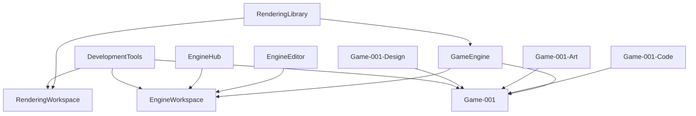

# 依存関係

12 direct submodules plus nested `GameEngine/External/RenderingLibrary` registration. All URLs use HTTPS and all child repositories are public, so no public parent depends on private content. Nested sources remain pinned by gitlink SHA; recursive clone is required. `EngineHub` is included in EngineWorkspace for unified source development; standalone product dependency remains optional.
